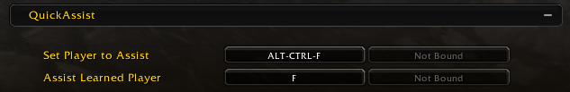
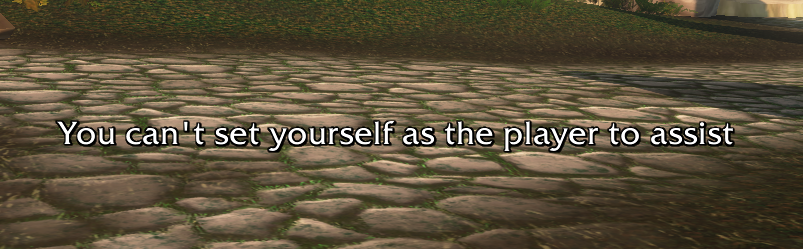

# QuickAssist

A small World of Warcraft addon for WoW retail and WoW Forever. Remember a friendly player with one key, then assist their target with another.

It replaces the usual `/assist <name>` macro: no macro to edit when the player you follow changes, just target them and press a key.

## Install

1. Download `QuickAssist-1.3.1.zip` from the [latest release](https://github.com/Terrorskull/QuickAssist/releases/latest).
2. Unzip it into your `Interface/AddOns` folder (inside `_retail_` for WoW retail, or your WoW Forever install), so you end up with `AddOns/QuickAssist/QuickAssist.toc`.
3. If the game is already running, type `/reload`. A restart isn't needed.

## Usage

Type `/quickassist` (or `/qa`, if no other addon uses it) to open the Key Bindings panel, then find the **QuickAssist** section. You can also open it from Esc > Options > Key Bindings. Until both keys are set, QuickAssist reminds you of this each time you log in.

- **Set Player to Assist**: target a friendly player and press this key. You'll see "Assist set: Name Secondary".
- **Assist Learned Player**: press this key to target that player's target.

Good to know:
- Until you learn someone, the assist key just assists your current target, so you can bind it to your normal assist key.
- Press **Set Player to Assist** with nothing targeted to clear the learned player.
- QuickAssist remembers the player you set across `/reload` and logging out. Each character remembers its own player.
- You can't set yourself as the player to assist.
- If you change the player during combat, the change is queued and applied when combat ends.
- Players have a primary and a secondary name on WoW Forever. QuickAssist uses both, so two players who share a primary name can be told apart. On WoW retail it uses the player's name.

Slash commands (`/qa` works in place of `/quickassist`):
- `/quickassist`: open the Key Bindings panel.
- `/quickassist set Name`: set a player to assist by typing their name, without targeting them first. Use it when they are out of range.
- `/quickassist status`: show who you are assisting.
- `/quickassist sound`: turn the sounds played when you set a player, clear the player, or try to set yourself on or off. It is on by default, and this is the only setting.

## Compatibility

Tested on WoW retail (interface `120000`) and WoW Forever (interface `16001`), including assisting players from other realms on WoW retail. It has not been tested on other clients.

## Credits and license

QuickAssist is a modified version of [SimpleAssist](https://www.curseforge.com/wow/addons/simpleassist) 4.01 by Schnoggo. The original documentation is in `Readme.txt`.

Released under the Creative Commons Attribution-NonCommercial 3.0 Unported license (CC BY-NC 3.0), the same license as the original. Free to use and share with credit to the original author. Not for commercial use. See `LICENSE` for the details.

## Changes

See [CHANGELOG.md](CHANGELOG.md) for what changed from SimpleAssist.
